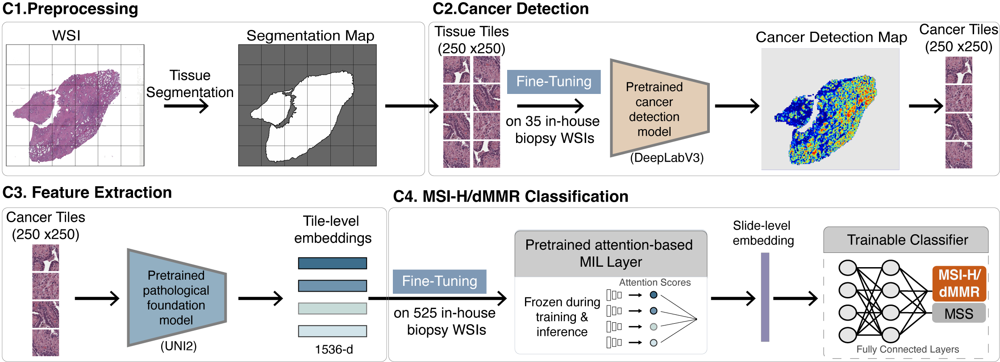

# Image-based Detection of Mismatch Repair Deficiency in Prostate Cancer Using Transfer Learning


## Publication

Liu L.J., Etzioni R., Zhang H., Sayar E., Richards H., Chen Z., et al., Pritchard C.C., Haffner M.C., and Harmon S. Image-based Detection of Mismatch Repair Deficiency in Prostate Cancer Using Transfer Learning. *Clinical Cancer Research (CCR).* Accepted, Aug 2026.

## 📋 Overview

This repository provides a step-by-step workflow for histopathology data analysis, from tile extraction and cancer detection to feature extraction, and MSI prediction, and additional exploratory analyses.

<p align="center">
  
</p>

---
## 📚 Table of Contents

- [🚀 Quick Start: Predict Four TCGA Cases and Generate Attention Heatmaps](#quick-start-predict-four-tcga-cases-and-generate-attention-heatmaps)

- [📦 Run Inference for all TCGA test data](#run-inference-for-all-tcga-test-data)

- [🧬 Mutation Prediction Pipeline](#-i-mutation-prediction-pipeline)
  - [Step 1 – Extract Tiles from WSI](#step-1-extract-tiles-from-wsi)
  - [Step 2 – Run Cancer Detection](#step-2-run-cancer-detection)
  - [Step 3 – Generate Embeddings](#step-3-generate-embeddings)
  - [Step 4 – Run Inference for MSI-H/dMMR Prediction](#step-4-run-inference-for-msi-hdmmr-prediction)
  - [Step 5 – Evaluate Model Performance](#step-5-evaluate-model-performance)
    
- [Environment Setup for the Full WSI Pipeline](#environment-setup-for-the-full-wsi-pipeline)
---

## Quick Start: Predict Four TCGA Cases and Generate Attention Heatmaps

Run PathStageMSI on four TCGA-PRAD example cases using precomputed, model-ready UNI2 features. 
### 1. Set up the environment
```bash
git clone https://github.com/lucasliu0928/PathStageMSI.git
cd PathStageMSI

conda env create -f env_files/mil.yml
conda activate mil
```

### 2. Check the example files
The following feature files should be in `tcga_examples/`:
```text
tcga_examples/
├── TCGA-XK-AAIW_uni2.h5
├── TCGA-HC-7747_uni2.h5
├── TCGA-HC-8216_uni2.h5
└── TCGA-HC-7737_uni2.h5
```
Download links for the four TCGA whole-slide images are listed in [`tcga_examples/WSI_DOWNLOAD_LINKS.txt`](tcga_examples/WSI_DOWNLOAD_LINKS.txt). The original WSI is not required for quick start. 

### 3. Run prediction

```bash
python3 -u inference/inference.py \
  --test_data \
    tcga_examples/TCGA-XK-AAIW_uni2.h5 \
    tcga_examples/TCGA-HC-7747_uni2.h5 \
    tcga_examples/TCGA-HC-8216_uni2.h5 \
    tcga_examples/TCGA-HC-7737_uni2.h5 \
  --model_dir locked_models \
  --threshold_csv configs/thresholds_summary.csv \
  --logit_priors_csv configs/logit_priors_summary.csv \
  --cuda_device auto \
  --output_dir output/tcga_four_examples
```

### 4. View prediction results

Results are saved in `output/tcga_four_examples/`:

- `ensemble_prediction.csv`: case-level scores and predictions.
- `ensemble_performance.csv`: performance on the four example cases.

In the prediction CSV:

- `mean_adj_prob`: mean adjusted positive-class probability across the five folds.
- `majority_class`: majority-vote prediction across folds; `1` indicates MSI-H/dMMR positive and `0` indicates negative.
- `True_y`: ground-truth label supplied with the example data.

### 5. Generate attention heatmaps for the four cases

```bash
python3 -u inference/generate_attention.py \
  --test_data \
    tcga_examples/TCGA-XK-AAIW_uni2.h5 \
    tcga_examples/TCGA-HC-7747_uni2.h5 \
    tcga_examples/TCGA-HC-8216_uni2.h5 \
    tcga_examples/TCGA-HC-7737_uni2.h5 \
  --model_dir locked_models \
  --cuda_device auto \
  --output_dir output/tcga_four_examples
```

For each case, the following files are saved under `output/tcga_four_examples/ensemble_attention/`:

- `<SAMPLE_ID>_ensemble_attention_plot_data.csv`: tile coordinates, raw ensemble attention (`mean_att`), and normalized plotting values (`attention_heatmap_value`).
- `<SAMPLE_ID>_ensemble_attention.png`: attention heatmap.

These four cases provide a quick demonstration. See **Other Example Data** below for the complete TCGA test dataset.

---

## 📦 Run Inference for all TCGA test data

The model-ready TCGA-PRAD example inference dataset is available on Zenodo:
[Download example data from Zenodo](https://doi.org/10.5281/zenodo.22089643)

See [Step 4: Run Inference for MSI-H/dMMR Prediction](#step-4-run-inference-for-msi-hdmmr-prediction) for inference instructions.  
See [Step 5: Evaluate Model Performance](#step-5-evaluate-model-performance) for bootstrapped performance estimates.

## 🧬 Mutation Prediction Pipeline
Before running the full pipeline, follow [Environment Setup for the Full WSI Pipeline](#environment-setup-for-the-full-wsi-pipeline).
Run each command block below starting from the repository root.

### Step 1: Extract Tiles from WSI

This step processes the Whole Slide Image (WSI) into tiles (e.g., keeping tiles with tissue coverage > 0.9 and white space < 0.9).

```bash
conda activate paimg9
cd cancer_detection_feature_generation
python3 -u 1_extract_patches_fixed-res.py \
  --cohort_name TCGA_PRAD \
  --pixel_overlap 0
```

**Generated output:**
- `sampleid_tiles.csv`    — Metadata of the extracted tiles containing white space % and tissue coverage %
- `sampleid_low-res.png`  — Low-resolution WSI image  
- `sampleid_tissue.png`   — Detected tissue mask image
- `sampleid_tissue.json`  — Tissue region annotations  
---

### Step 2: Run Cancer Detection

This step applies a trained cancer detection model to the extracted tiles.

```
conda activate paimg9
cd cancer_detection_feature_generation
python3 -u 2_cancer_inference_fixed-res.py --cohort_name TCGA_PRAD  --fine_tuned_model True --pixel_overlap 0 
```

**Generated output:**
- `sampleid_TILE_TUMOR_PERC.csv` — Tile-level cancer probability and metadata  
- `sampleid_cancer_prob.jpeg` — Cancer prediction probability heatmap  
- `TILE_@#_X#Y#_TF#.png` — Top 5 tiles with the highest tumor fraction  
  - `@#`: Magnification level  
  - `X#`, `Y#`: Tile coordinates  
  - `TF`: Tumor fraction score  
- `sampleid_cancer.json` — Cancer region annotations
  
### Stain Normalization

Stain normalization is enabled by default (`--stain_norm norm`) for both cancer detection (Step 2) and embedding extraction (Step 3). Tiles are normalized using HistomicsTK's `deconvolution_based_normalization()` with the reference image included in this repository:

`stain_norm_img/SU21-19308_A1-2_HE_40X_MH110821_40_16500-20500_500-500.png`

To disable stain normalization, add `--stain_norm no_norm` to the corresponding command.

### Step 3: Generate Embeddings

This step uses selected foundation models to compute tile-level embeddings. 

```
conda activate paimg9
python3 -u cancer_detection_feature_generation/4_get_feature.py --cohort_name TCGA_PRAD --pixel_overlap 0 --fine_tuned_model True --feature_extraction_method uni2
```

**Supported models:** `retccl`, `uni1`, `uni2`, `prov_gigapath`, `virchow2`.
**Generated output:**
- `sampleid/features_alltiles_modelname.h5` — Tile-level embedding features  
  - `modelname`: One of `retccl`, `uni1`, `uni2`, `prov_gigapath`, `virchow2`
    

### Step 4: Run Inference for MSI-H/dMMR Prediction

This step runs locked models for MSI prediction.

```bash
conda activate mil
cd inference
python3 -u inference.py \
  --test_data /path/to/test_data.pth \
  --model_dir locked_models \
  --output_dir output/predictions \
  --threshold_csv configs/thresholds_summary.csv \
  --logit_priors_csv configs/logit_priors_summary.csv
```

### Step 5: Evaluate Model Performance
If ground-truth labels are available in the prediction CSV, compute bootstrap confidence intervals:

```bash
cd inference
python3 bootstrap_performance.py \
  --prediction_csv output/predictions/ensemble_prediction.csv \
  --output_csv output/predictions/bootstrap_performance.csv \
  --cohort_name test
```

## Environment Setup for the Full WSI Pipeline
### Clone the repository

```bash
git clone https://github.com/lucasliu0928/PathStageMSI.git
cd PathStageMSI
```

### Cancer detection and feature extraction environment
```
conda env create -f env_files/paimg9.yml
conda activate paimg9
```

### MSI prediction environment
```
conda env create -f env_files/mil.yml
conda activate mil
```

### Main dependencies
* For cancer detection
   - Python 3.8.20  [GCC 13.3.0]
   - cv2 == 4.10.0
   - fastai == 2.7.10
   - torch == 2.4.1+cu121
   - torchvision == 0.19.1+cu121
   - openslide == 1.3.1
   - histomicstk == 1.3.14 (python -m pip install histomicstk --find-links https://girder.github.io/large_image_wheels)
* For MSI prediction
  - Python 3.9.23 [GCC 13.3.0]
  - torch == 2.8.0
  - torchvision == 0.23.0
  - pandas == 2.3.2
  - numpy == 1.26.4
  - scipy == 1.13.1
  - scikit-learn == 1.6.1
  - h5py == 3.14.0
  - tqdm == 4.67.1
  - nystrom-attention == 0.0.14
  - einops == 0.8.1


## Authors
Lucas J. Liu 
jliu6@fredhutch.org

## Version History
* 0.1
    * Initial Release


